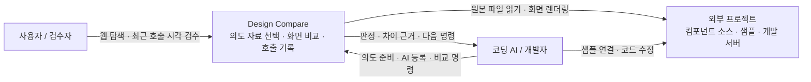

# C1 · 시스템 맥락

Design Compare는 디자인 자료를 찾아 AI에 전달하고, 원본과 개발 화면의 차이를 검사하는 로컬 시스템이다. 사람은 화면과 제품 맥락을 검수하고, 코딩 AI는 자료 조회·분류·등록·수정·재검사를 수행한다.

## 관계와 책임

- Design Home의 트렌드 예제와 실마리 compos는 연결할 수 있는 원본이다. 컴포넌트 자체는 연결된 프로젝트가 소유한다.
- CLI가 의도에 맞는 자료를 선택해 이미지와 설명을 제공하고, 코딩 AI가 구현과 등록 자료 작성을 수행한다. CLI는 AI 서비스를 호출하지 않으며 프로젝트 코드를 자동 수정하지 않는다.
- 비교 자료는 로컬 파일에 저장한다. CLI가 외부 AI API에 결과를 전송하는 흐름은 없다.
- 검사 통과는 정한 스타일·좌표·픽셀 조건의 통과다. 사용성과 디자인 적합성은 검수자가 판단한다.

다음 단계: [C2 · 컨테이너](c2-containers.md).

## 공개 Design Library

사용자 화면 이름은 Design Library이며, 내부 비교 모듈과 CLI는 Design Compare를 유지한다. Design Home 랜딩에서 `/design-library/`로 진입한다. GitHub Pages에서는 공개 디자인 문서·미리보기만 제공하고, 등록 작업과 호출 기록은 로컬 서버에서 조회한다.
