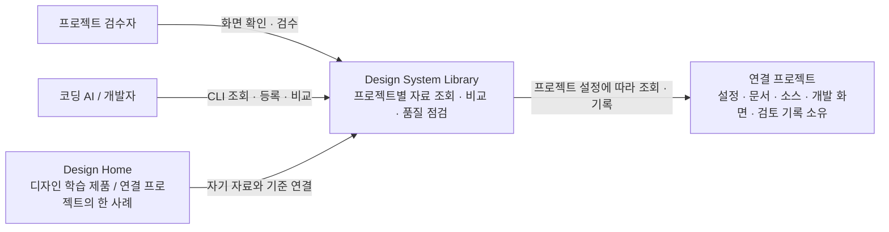

# C1 · 시스템 맥락

Design System Library는 프로젝트마다 설치해 디자인 기준과 개발 화면을 검토하는 도구다. Design Home은 디자인을 공부하는 별도 제품이며 이 도구를 사용하는 프로젝트 중 하나다.

프로젝트가 자료·브랜드·기준·저장 위치를 소유한다. 도구는 학습용 콘텐츠나 Design Home 서버를 기본 의존성으로 갖지 않는다. 각 설치본은 자기 설정과 기록을 사용하며 중앙 서비스나 Git 훅이 필요하지 않다. CI가 필요하면 같은 CLI의 종료 코드를 사용한다.

사람은 사용성과 적합성을 판단하고 AI는 자료 조회·구현·재검사를 수행한다. 스타일·좌표·픽셀 검사 통과는 해당 비교 조건의 통과이며, 기본 UI 신호는 검토 대상이다.

다음 단계: [C2 · 실행 단위](c2-containers.md) → [C3 · 모듈](c3-components.md) → [C4 · 코드 계약](c4-code.md).
