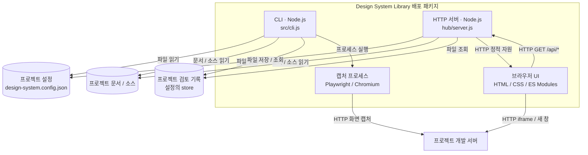

# C2 · 컨테이너

독립 배포 단위는 `design-compare` Node 패키지다. CLI와 HTTP 서버는 공통 모듈을 공유하고, 브라우저 UI와 캡처용 Chromium은 별도 실행 환경이다. 프로젝트별 설치는 서버나 저장소를 공유하지 않는다.

| 실행 단위 | 진입점 | 책임 |
|---|---|---|
| CLI | `design-compare` / `src/cli.js` | JSON·종료 코드·조회·등록·비교 |
| HTTP 서버 | `design-system-library` / `hub/server.js` | 프로젝트 정보·자료·기록 API와 공통 UI 제공 |
| 브라우저 UI | `hub/web/app.js` | 현재 프로젝트 표시·자료 탐색·시각 검수·품질 도구 |
| Chromium | `src/capture/index.js` | 조건 고정·DOM 측정·캡처 |
| 프로젝트 저장소 | 설정의 `documentsRoot`, `sourceRoot`, `store` | 프로젝트 소유 데이터. 도구 배포물에 포함하지 않음 |

`npm pack`의 `prepack`이 공통 UI와 공유 자원을 `dist/runtime`에 묶는다. 설치본은 이 자원만 제공하고 프로젝트 개발 서버는 `baseUrl`로 연결한다. Design Home의 문서·미리보기·학습 사이트는 배포물에 포함하지 않는다. 설정이 없으면 빈 프로젝트로 시작하며 공통 품질 도구는 사용 가능하다.

저장소 내 개발에서는 Design Home 호스트가 같은 UI를 `/design-library/`에 연결한다. `design-home-library/documents`와 프로젝트 설정은 Design Home 소유다. 정적 Pages용 export는 해당 프로젝트의 읽기 전용 카탈로그·맥락·프로젝트 이름을 내보낸다. 로컬 기록은 공개 export에 포함하지 않는다.

다음 단계: [C3 · 모듈](c3-components.md).
