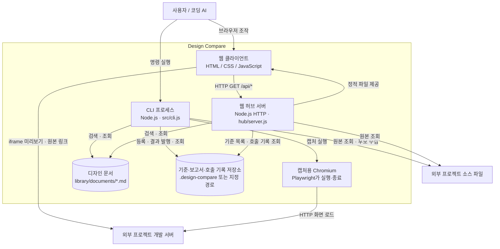

# C2 · 컨테이너

Design Compare는 한 Node 패키지의 모듈을 CLI 프로세스와 웹 서버 프로세스가 공유한다. 별도 모듈마다 서버를 띄우는 구조가 아니다. 브라우저 클라이언트와 캡처용 Chromium은 서로 다른 실행 환경이다.

## 실행·저장 단위

| 단위 | 구현 진입점 | 역할 |
|---|---|---|
| CLI 프로세스 | [`src/cli.js`](../../src/cli.js), [`design`](../../design) | 입력·JSON 출력·종료 코드와 수집·등록·비교 작업 |
| 웹 서버 | [`hub/server.js`](../../hub/server.js) | GET 검색·원본 조회·기준·호출 기록 조회와 정적 파일 제공 |
| 웹 클라이언트 | [`hub/web/app.js`](../../hub/web/app.js) | 태그 탐색·iframe·문서 표시·제품 원본 링크 |
| Chromium 프로세스 | [`src/capture/index.js`](../../src/capture/index.js) | 실제 DOM 측정과 안정적인 이미지 캡처 |
| 디자인 문서 저장소 | [`library/documents/`](../../library/documents/) | 분류·설명·원본 연결의 단일 원본 |
| 기준·보고서 저장소 | [`src/catalog/index.js`](../../src/catalog/index.js) | 연결 정보 또는 사진 기준, 실행별 비교 결과와 호출 기록 |

## 실행 관계

허브의 트렌드 미리보기는 허브가 제공하는 같은 저장소의 정적 HTML을 iframe으로 연다. 외부 프로젝트는 자체 개발 서버가 필요하다. 캡처는 CLI에서 실행하며 허브에는 비교 실행 HTTP 엔드포인트가 없다. 비교 보고서는 정적 HTML이라 생성 후 서버 요청 없이 파일로 검토할 수 있다.

문서 경로와 소스 경로, 저장소 설정은 [문서와 메타데이터](../library.md)와 [작업 흐름](../workflows.md)에서 확인한다.

다음 단계: [C3 · 컴포넌트](c3-components.md).

## 정적 Pages 배포

`npm run build:library`가 Library 문서와 맥락을 `design-library/data/` JSON으로 내보낸다. 저장소 루트의 `design-library/index.html`은 로컬과 Pages가 공유하는 SPA 셸이다. Pages 브라우저는 정적 JSON과 순수 검색 함수를 사용하며 Node API를 호출하지 않는다. 미리보기 경로는 저장소 배포 접두사 기준으로 변환한다. URL의 hash 경로로 분류·상세·검색 상태를 유지해 새로고침과 직접 링크가 정적 서버에서 동작한다.

로컬 서버 `/`는 Design Home 랜딩, `/design-library/`는 API 모드의 같은 SPA를 제공한다. 등록 작업·호출 기록은 로컬 모드에서만 표시한다.
