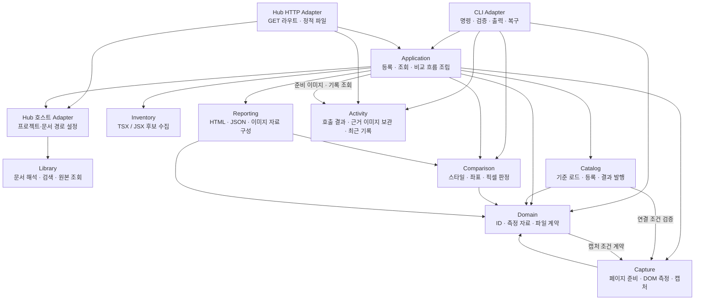
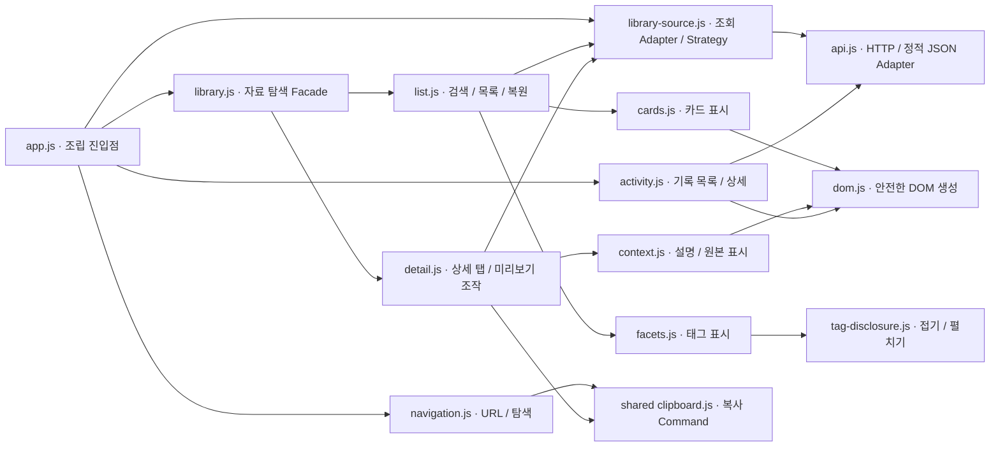

# C3 · 컴포넌트

Node 실행 컨테이너의 주요 모듈을 보여준다. CLI와 허브는 같은 소스 모듈을 사용하지만 진입 경로는 다르다. 화살표는 호출·의존 방향이다.

## 모듈별 코드 진입점

| 컴포넌트 | 코드 | 책임 |
|---|---|---|
| CLI Adapter | [`src/cli/index.js`](../../src/cli/index.js), [`commands.js`](../../src/cli/commands.js) | 명령을 Application에 전달하고 종료 코드·요약·복구 안내 제공 |
| Hub HTTP Adapter | [`hub/server.js`](../../hub/server.js) | 검색·맥락 조회는 호스트 Adapter, 기준 조회는 Application, 호출 기록은 Activity 호출 |
| Application | [`src/application.js`](../../src/application.js), [`application/compare.js`](../../src/application/compare.js) | 저장소·캡처·파일 읽기·시간 Adapter를 조립하고 작업 흐름 실행 |
| Hub 호스트 Adapter | [`src/hub/index.js`](../../src/hub/index.js), [`context.js`](../../src/hub/context.js), [`search.js`](../../src/hub/search.js) | 현재 프로젝트 위치를 Library 설정으로 변환 |
| Library | [`src/library/index.js`](../../src/library/index.js) | `createLibrary`의 검색·의도 선택·조회로 문서와 원본 접근; 태그·문서 검증도 내부 소유 |
| Activity | [`src/activity/index.js`](../../src/activity/index.js) | CLI 출력과 제공 이미지의 보관·최근 10건 조회·허용 파일 읽기 |
| Inventory | [`src/application/inventory.js`](../../src/application/inventory.js) | 프로젝트 파일의 내보낸 이름과 미리보기 파일을 정적 수집 |
| Catalog | [`src/catalog/index.js`](../../src/catalog/index.js), [`linked.js`](../../src/catalog/linked.js) | 사진·연결 기준 저장, 자료 검증, 실행별 파일 발행 |
| Capture | [`src/capture/index.js`](../../src/capture/index.js), [`page.js`](../../src/capture/page.js) | Chromium 실행·종료, 조건 고정, 샘플 열기, 측정·이미지 준비 |
| Comparison | [`src/comparison/index.js`](../../src/comparison/index.js) | 순수 측정값·이미지 비교, 허용 정책과 판정; 수정 방향은 차이에서 파생 |
| Reporting | [`src/reporting/artifacts.js`](../../src/reporting/artifacts.js) | 판정에서 정적 HTML·report.json·repair.json·이미지 생성 |
| Domain | [`src/domain/records.js`](../../src/domain/records.js)와 같은 폴더 | 기준·보고서·ID·부분 매핑·파일명 공통 계약 |

Library는 웹 DOM·CLI 출력·현재 저장소의 디렉터리 구조를 모른다. 원본 위치는 호스트가 전달하고 문서는 Library가 읽는다. Catalog의 실행 결과 저장과 Library의 디자인 문서 관리는 서로 다른 책임이다. 현재 Domain의 자료 검증은 Capture의 조건 계약을 참조하고 Capture는 Domain의 ID 규칙을 참조한다. 이 상호 의존도는 현 코드 그대로 표시했다.

## 비교 흐름

Application은 Catalog에서 기준을 읽는다. 원본 연결이면 Capture로 현재 원본을 렌더링하고, 사진 기준이면 저장된 이미지와 측정값을 읽는다. 개발 화면을 캡처한 뒤 Comparison이 판정하고 Reporting이 결과 파일을 구성한다. Catalog가 파일을 발행하면 CLI가 요약과 다음 명령을 출력한다.

## 웹 클라이언트 내부

[`hub/web/`](../../hub/web/)는 Library를 직접 import하지 않고 HTTP 결과를 표시한다. 비교 보고서의 브라우저 동작은 Reporting이 생성하는 정적 HTML 내부에 포함된다.

CLI가 AI에게 출력하는 지점에서 Activity 기록을 발행한다. 작업 전 준비의 PNG와 비교·조회 근거는 해당 호출에 보관하며, 웹은 보관된 자료를 읽는다.

C4는 위 진입점의 실제 코드다. 함수·클래스 목록은 별도 문서로 복제하지 않는다.

## 탐색 리팩토링의 판단

기존 웹 진입점은 요청, 선택 상태, 자료 표시와 기록 탐색을 함께 처리해 SRP(한 가지 변경 이유)와 관심사 분리에 취약했다. `app.js`는 조립만 수행하고, 자료와 기록 컨트롤러는 같은 `show(route, current)` 계약을 구현한다. 메뉴별 컨트롤러 선택에는 작은 Strategy 등록표를 사용한다. 클래스 계층이나 이벤트 버스는 추가하지 않았다.

선택한 분류·자료·검색어·태그·설명 탭은 URL이 단일 진실 공급원이다. 목록과 상세는 동시에 표시하지 않는다. 이전 목록의 스크롤·포커스만 임시 보관한다. 웹과 CLI의 분류·검색·설명은 같은 Library 메타데이터에서 나온다. 컴포넌트 미리보기는 기존 렌더러에 필터를 전달하므로 복제된 샘플을 유지하지 않는다.

LSP·ISP를 위한 별도 상속·거대 인터페이스가 없는 구성이다. HTTP 접근을 `api.js`에 모아 화면 표시와 통신을 분리했지만, 브라우저 DOM에 불필요한 DI 계층을 만들지는 않았다. 이는 현재 규모에서 이해 비용을 줄이기 위한 선택이다.

## 정적 호스트 Adapter

`src/library/query.js`는 문서 배열을 받는 순수 검색 함수다. 파일을 읽는 `search.js`와 브라우저 `hub/web/api.js`가 함께 사용한다. `scripts/export-library.mjs`는 같은 Library의 문서·맥락을 공개 JSON으로 내보내며 로컬 절대 경로와 실행별 기록을 포함하지 않는다. HTTP와 정적 JSON의 선택, Pages 접두사 처리와 다운로드 경로는 `api.js`가 담당한다.

## 미리보기 이미지와 스크롤 인터랙션

`export-previews.mjs`는 문서의 샘플 URL·뷰포트·캡처 선택자를 Chromium으로 렌더링해 목록 이미지를 생성한다. 브라우저 `cards.js`는 이미지를 지연 로드하고 `context.js`는 상세 화면에서 실제 샘플을 연다. 공통 `shared/js/scrollbar.js`는 스크롤 영역의 위치·크기·입력과 수명주기를 소유하며 네이티브 휠·터치 스크롤을 유지한다. 자동 숨김과 접근 확장은 `shared/css/scrollbar.css`가 표시한다.

## 프레젠테이션 책임과 단일 소스

`library.js`는 탐색의 `show(route, current)` 계약만 제공한다. 목록의 검색·태그·위치 복원은 `list.js`, 상세의 탭·크기·복사 조작은 `detail.js`가 소유한다. `library-source.js`는 조립 진입점에서 전달받은 읽기 함수를 사용하며 DOM·브라우저 전역 없이 등록 작업과 카탈로그를 같은 표시 모델로 변환한다. 실제로 다른 두 조회 방식에만 Strategy와 Adapter를 적용한다.

렌더링은 목록 카드와 상세 맥락으로 나누고 공통 DOM 생성에 의존한다. 기록·태그 모듈은 자료 렌더러를 경유하지 않는다. 자료 종류의 표시 이름은 `design-presentation.js`, 아이콘 도형은 공통 SVG sprite, 복사 피드백은 공통 Command 바인딩이 소유한다.

웹의 스타일 진입점은 CSS 의존 순서만 선언하고 기본·탐색·검색·카드·태그·상세·미리보기·설명·기록·모션으로 나눈다. 추가 덮어쓰기 스타일시트는 사용하지 않는다. 홈도 기본·히어로·미리보기·컬렉션·탐색으로 구분하며 색상과 모션 토큰은 `shared/css/interface.css`에서 관리한다. 한국어 기본 문구는 HTML이 소유하고 영어 번역만 별도 데이터로 관리한다. 홈 미리보기의 스타일 식별자와 표시 이름은 선택 버튼의 데이터에서 읽으며, 이미지 로드가 성공한 최신 요청만 선택 상태에 반영한다.

## 내부 컴포넌트 샘플

`ui-components/js/sample-definition.js`의 Definition Factory가 실제 HTML과 공식 문서 연결을 소유한다. 코드 복사 창과 별도 예제 생성 파이프라인은 두지 않는다. 카테고리 파일은 선언적 정의를 등록하고, `canvas-renderer.js`는 전달받은 `mount` 함수를 통해 조작을 연결한다. 표시 코드에 전역 핸들러나 인라인 스타일을 넣지 않는다.

`samples/runtime.js`의 Strategy 등록표는 폼·선택·탐색·레이어·피드백·순서 변경 동작을 연결한다. 각 동작은 샘플 루트와 수명주기 scope만 받는다. `lifecycle.js`는 이벤트 중단·타이머 취소·레이어 해제를 소유하며 카테고리 또는 검색 변경 시 렌더러가 이를 해제한다. 피드 로딩 상태는 인스턴스 내부에 있고, 기존 피드 호출 함수는 조립 진입점의 호환 Adapter로만 유지한다.

선택 Command는 탭·분할 선택·메뉴의 선택 상태와 본문 갱신을 한 곳에서 처리한다. 알림 Command는 표시·자동 닫기·실행 취소를 소유한다. 캐러셀·통합 메뉴·페이지네이션 데이터는 `samples/data.js`가 소유하며 표시와 상태를 별도로 복제하지 않는다. 샘플 스타일은 `css/controls/`에서 책임별로 나누고 의미별 색상은 공통 interface 토큰을 사용한다. 상속 계층·거대 인터페이스·범용 이벤트 버스는 추가하지 않았다.

사이드바 샘플은 본문과 같은 레이아웃의 지속형 탐색 영역을 보여주고, 드로어 샘플은 열기·닫기·Escape가 있는 오버레이 패널을 보여준다. 사이드바의 모양·레이아웃과 드로어의 표시 방식이 구분되도록 시연 맥락을 제공한다.

## Patterns의 단계별 탐색

`pattern-topics/`의 카테고리별 정의는 여섯 학습 분야와 세부 주제가 참조하는 원본 샘플 ID를 소유하고, `pattern-taxonomy.js`가 등록된 정의를 연결한다. 모션·접근성에서 기존 샘플을 다시 연결하지만 HTML·동작·스타일을 복제하지 않는다. `pattern-route.js`의 해시 경로가 분야·세부 주제·검색 상태의 단일 원본이다. `pattern-navigation.js`는 경로 검증과 세션별 마지막 세부 주제 복원을 소유하고 명시적인 URL로 반영한다. 브라우저 history 이벤트가 같은 URL을 중복 전달하면 다시 렌더링하지 않는다. 조립 진입점은 이 탐색 계약을 화면에 연결한다.

`pattern-tree.js`는 상위 분야와 세부 바로가기를, `pattern-overview.js`는 처음 표시되는 분야 목록을 소유한다. `disclosure.js`는 포커스·inert·열림 상태·중단 가능한 높이 전환·동작 줄이기를 처리한다. 호출자가 단계별 단일 선택을 결정한다. 렌더러는 같은 분야에서 세부 주제만 바뀌면 기존 샘플을 재생성하지 않으며, 분야 또는 검색 결과가 바뀔 때만 수명주기를 해제한다. 링크·키보드·뒤로가기·새로고침이 같은 탐색 상태를 사용한다.

`pattern-viewport.js`는 스크롤과 취소 가능한 포커스 인계를 담당한다. 렌더러가 제공하는 대상·전환 완료 계약만 사용하며 내부 DOM ID나 애니메이션 선택자를 알지 않는다. 아코디언은 다음 열림 상태를 콜백으로 전달하고 ARIA는 상태의 표시 결과로만 사용한다. 렌더러는 샘플 해제와 함께 전환을 취소한다. 검색 포커스 동작은 조립 지점에서 주입한다.

## 난이도와 모션 샘플의 확장

난이도 메타데이터는 Definition Factory, 공통 표시 이름은 `pattern-levels.js`가 소유한다. `pattern-level-view.js`는 펼친 주제의 Basic과 Advanced를 연속된 섹션으로 표시한다. 해당 난이도의 정의가 없으면 섹션을 만들지 않는다. 난이도 전환 탭이나 카드 숨김은 없으며, 카드 DOM은 한 번만 생성한다. 기존 level URL은 열 수 있지만 표시 순서는 Basic → Advanced다.

`canvas-renderer.js`는 화면 선택과 샘플 mount/dispose만 소유한다. 분야의 계층과 전환 계약은 `pattern-topic-view.js`, 검색 결과와 초기화 표시는 `pattern-search-view.js`, 카드 표시는 `sample-card.js`가 담당한다. 분야·검색·개별 표본은 같은 카드 Factory를 사용한다.

모션 정의·동작·스타일은 원리와 전환(`motion-foundations`), 공간과 스크롤(`motion-spatial`), 감각적인 표현(`motion-expressive`)으로 나뉜다. 등록한 정의는 한 번만 존재하고 학습 분류에서 ID로 연결한다. `motion-controller.js`는 공통 WAAPI 재생·대상별 중단·완료·scope 해제와 동작 줄이기·숨김을 처리한다. 표시 효과가 생략되거나 취소되어도 최종 데이터와 상태 변경은 각 샘플이 보장한다. RAF 수치 보간과 스크롤·포인터 직접 조작은 해당 동작 모듈이 소유한다. 범용 플러그인 계층이나 새 애니메이션 의존성은 추가하지 않았다.

## 화면 구조·복합 입력·작업 흐름·접근성

화면 구조와 탐색은 `layout-patterns`, 표와 복합 입력은 `data-patterns`, 직접 검증할 접근성 예제는 `accessibility-patterns`의 정의·동작·스타일이 소유한다. 업무 예제의 선언은 `components/workflow-patterns.js`, 동작의 공개 조립은 `samples/workflow-patterns.js`가 맡으며 내부 편집·선택·명령과 진행·저장·알림은 각각 `workflow-interactions.js`와 `workflow-feedback.js`로 나뉜다. 공통 scope와 의미별 토큰을 사용하고 상태를 DOM 외부의 전역 저장소에 복제하지 않는다.

같은 샘플을 여러 학습 분야에 연결할 때 카테고리별 원본 ID만 참조한다. 같은 카테고리에서는 한 번만 배치해 입력·레이어의 DOM ID를 중복 생성하지 않는다. 정의 helper는 이름 있는 객체로 Factory를 호출한다. 독립적인 작업에는 공통 부모 클래스나 범용 상태 기계를 강제하지 않는다. 실제 변형 연결은 기존 Strategy 등록표를 사용한다.

테이블은 네이티브 행·열 관계와 정렬 상태를 제공하고 좁은 컨테이너에서는 본문 안의 가로 스크롤과 안내를 사용한다. 계층 목록은 네이티브 details, 명령 팔레트는 네이티브 dialog와 실제 버튼 포커스를 사용한다. 저장·연결·비동기 작업은 명시적인 카드 내부 시뮬레이션이며 scope가 타이머를 해제한다. 자동 저장은 새 입력마다 이전 작업을 취소하고 버전을 검증한다. 적응형 사이드바는 화면 축소로 숨겨지는 포커스를 메뉴 버튼으로 복원한다.

## 렌더링 비용과 수명주기

카테고리를 선택하면 주제 구조만 만든다. `pattern-level-view.js`는 실제로 펼친 주제의 카드만 생성하고 렌더러는 새 루트에만 동작을 연결한다. 처음 열었던 카드와 scope는 같은 카테고리 안에서 보관해 접고 다시 펼쳐도 상태를 잃지 않는다. 동일한 표본 또는 동일한 정규화 검색 경로는 재렌더링하지 않는다. `lifecycle.js`는 AbortSignal을 종료 상태의 원본으로 사용하고 중복 해제와 종료 후 비동기 작업 등록을 방지한다.

공통 스크롤바는 `scrollbar.js`의 영역 등록·관찰, `scrollbar-axis.js`의 축별 표시·입력 Command, `scrollbar-frame.js`의 프레임 예약으로 나뉜다. 외부 계약은 `update/dispose`만 제공한다. 한 프레임의 모든 영역 위치·크기·색상·스크롤 값을 먼저 읽은 뒤 레일을 표시하며 네이티브 스크롤과 리사이즈 신호를 묶는다. MutationObserver는 새 영역의 발견·제거·숨김만 처리하고, 텍스트 변경으로 문서 전체를 다시 검사하지 않는다. 직접 콘텐츠의 ResizeObserver가 실제 크기 변화를 감지한다.

## Libraries 도구 탐색과 비교

`libraries/js/catalog/*`는 역할별 선택 기준·공식 링크의 원본이고 `catalog.js`는 이를 조립한다. 카테고리 ID는 각 역할 정의 한곳에만 두고 라이브러리의 분류 값을 여기서 파생한다. `route.js`는 URL의 검색·카테고리·최대 3개 비교 ID를 검증한다. `library-card.js`와 `comparison.js`는 같은 원본과 `elements.js`의 기준·링크 Factory를 사용한다. `app.js`는 상태를 URL에서 읽어 화면에 투영하고 이벤트를 조립한다. Patterns와 Libraries의 접힘 애니메이션은 `shared/js/disclosure.js`가 소유하며 기존 Patterns 진입점은 이를 다시 내보낸다. 외부 라이브러리를 설치하거나 페이지에 로드하지 않는다.

Patterns의 종류별 분류는 `pattern-topics/*`, UX 관점의 원칙 분류는 `pattern-principles.js`가 원본 샘플 ID를 참조한다. `pattern-taxonomy.js`는 두 탐색 투영을 같은 카탈로그에 연결한다. 보기 기준은 `pattern-route.js`의 `view`가 소유하고, `pattern-view-switcher.js`는 네이티브 라디오 선택을 URL에 전달한다. 트리·개요·검색·브레드크럼은 현재 보기 기준을 유지하며 예제의 마크업과 동작은 복제하지 않는다.

상태 변형 예제는 `components/state-morphing.js`의 정의, `samples/state-morphing.js`의 상태·취소·포커스 처리, `controls/state-morphing.css`의 표현으로 나뉜다. 재생·전송은 명시적인 로컬 시뮬레이션이며 타이머는 기존 scope가 해제한다. 원칙별 그룹은 같은 카테고리 내 샘플 ID를 중복 배치하지 않아 캐시된 DOM의 ID와 동작을 격리한다.

주제 선택 정책은 `pattern-route.js`의 `selectPatternGroup`이 소유하며 아코디언과 숏컷이 같은 선택 명령을 사용한다. Libraries의 카테고리 투영·접힘 수명은 `category-view.js`, 카드와 비교 표의 표시 항목 스키마는 `fields.js`가 소유한다. `app.js`는 URL 전환·화면 조립·이벤트 연결만 맡는다. 상태 변형 버튼의 phase는 동작 모듈 안에 한 번만 존재하고 DOM 속성과 텍스트는 render 함수가 파생한다.

## 용어집의 시각적 학습

`glossary/js/catalog.js`는 UI 용어의 큐레이션과 UX 원리의 샘플 연결만 소유한다. UI 정의와 동작은 기존 Patterns의 Definition Factory·카탈로그·runtime, UX 원리는 `pattern-principles.js`를 참조한다. 용어집은 예시를 복제하지 않는다. 피츠·힉·근접성의 원리별 비교 실험만 `glossary/js/ux-demos.js`가 소유하며 같은 수명주기 scope로 해제한다.

`route.js`의 해시 경로가 분류·용어 상세·검색의 원본이다. `app.js`는 접힌 UI/UX 분류, 세 열 표, 한 번에 하나의 행 내 체험, 고유 주소의 상세 화면을 조립한다. 검색은 두 분류를 함께 탐색한다. 도식은 `visual.js`, 반응형 표시와 체험 영역 스타일은 `css/glossary.css`가 소유한다. 체험을 바꾸거나 화면을 떠나면 이전 이벤트·타이머·레이어를 해제하고 BFCache 복원 시 다시 연결한다. 정적 호스트에서도 같은 상대 경로와 해시 주소를 사용한다.
