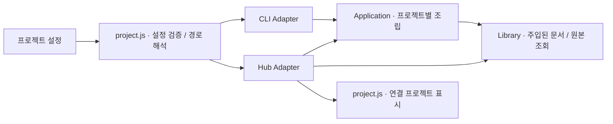
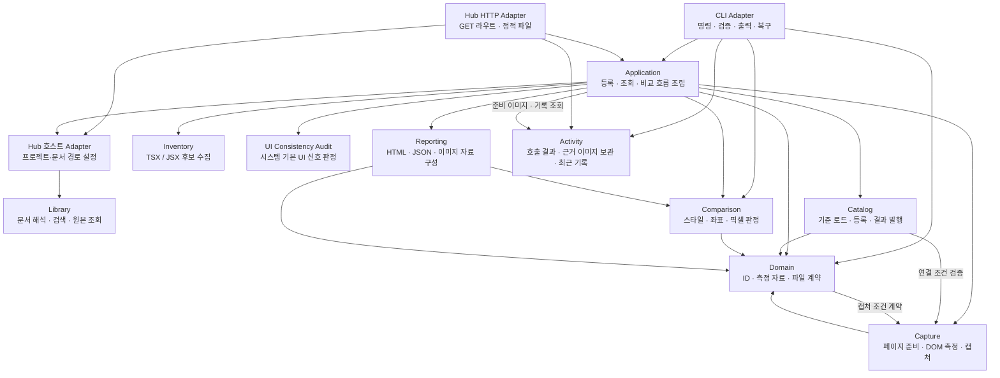
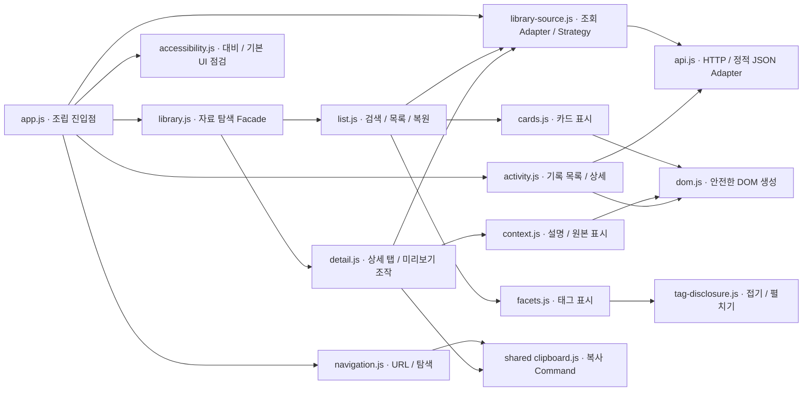

# C3 · 컴포넌트

## 프로젝트 경계

`src/project.js`가 프로젝트 소유의 `design-system.config.json`을 읽어 경로를 정규화한다. CLI와 서버가 이 계약을 사용한다. `createApplication({ project })`와 `createHubServer({ project })`는 프로젝트별 Library 인스턴스를 조립하며 서버 간 카탈로그·store를 공유하지 않는다. `src/hub/`는 기존 호출자의 호환 진입점이다. Design Home 문서는 도구 밖의 `design-home-library/documents/`에 있다.

검토 화면 원본은 `hub/index.html`이 소유한다. `scripts/package-runtime.mjs`는 이 화면과 공용 자원만 배포물로 묶는다. Design Home의 공개 `design-library/index.html`은 `export-library.mjs`가 이 원본에 호스트 탐색을 붙여 생성한다. 브라우저의 `hub/web/project.js`는 API 또는 프로젝트 export에서 이름·연결 상태를 받아 표시한다. 구체 코드 계약: [C4](c4-code.md).

Node 실행 컨테이너의 주요 모듈을 보여준다. CLI와 허브는 같은 소스 모듈을 사용하지만 진입 경로는 다르다. 화살표는 호출·의존 방향이다.

## 모듈별 코드 진입점

| 컴포넌트 | 코드 | 책임 |
|---|---|---|
| CLI Adapter | [`src/cli/index.js`](../../src/cli/index.js), [`commands.js`](../../src/cli/commands.js) | 명령을 Application에 전달하고 종료 코드·요약·복구 안내 제공 |
| Hub HTTP Adapter | [`hub/server.js`](../../hub/server.js) | 검색·맥락 조회는 호스트 Adapter, 기준 조회는 Application, 호출 기록은 Activity 호출 |
| Application | [`src/application.js`](../../src/application.js), [`application/compare.js`](../../src/application/compare.js), [`audit/ui.js`](../../src/audit/ui.js) | 저장소·캡처·파일 읽기·시간 Adapter를 조립하고 비교·UI 일관성 작업 흐름 실행 |
| Hub 호스트 Adapter | [`src/hub/index.js`](../../src/hub/index.js), [`context.js`](../../src/hub/context.js), [`search.js`](../../src/hub/search.js) | 현재 프로젝트 위치를 Library 설정으로 변환 |
| Library | [`src/library/index.js`](../../src/library/index.js) | `createLibrary`의 검색·의도 선택·조회로 문서와 원본 접근; 태그·문서 검증도 내부 소유 |
| Activity | [`src/activity/index.js`](../../src/activity/index.js) | CLI 출력과 제공 이미지의 보관·최근 10건 조회·허용 파일 읽기 |
| Inventory | [`src/application/inventory.js`](../../src/application/inventory.js) | 프로젝트 파일의 내보낸 이름과 미리보기 파일을 정적 수집 |
| Catalog | [`src/catalog/index.js`](../../src/catalog/index.js), [`linked.js`](../../src/catalog/linked.js) | 사진·연결 기준 저장, 자료 검증, 실행별 파일 발행 |
| Capture | [`src/capture/index.js`](../../src/capture/index.js), [`page.js`](../../src/capture/page.js) | Chromium 실행·종료, 조건 고정, 샘플 열기, 측정·이미지 준비 |
| Motion audit | [`src/audit/motion.js`](../../src/audit/motion.js) | 지정한 클릭 전후의 화면 차이와 전환 이벤트 관찰; 판단은 호출자에 남김 |
| Comparison | [`src/comparison/index.js`](../../src/comparison/index.js) | 순수 측정값·이미지 비교, 허용 정책과 판정; 수정 방향은 차이에서 파생 |
| Reporting | [`src/reporting/artifacts.js`](../../src/reporting/artifacts.js) | 판정에서 정적 HTML·report.json·repair.json·이미지 생성 |
| Domain | [`src/domain/records.js`](../../src/domain/records.js)와 같은 폴더 | 기준·보고서·ID·부분 매핑·파일명 공통 계약 |

Library는 웹 DOM·CLI 출력·현재 저장소의 디렉터리 구조를 모른다. 원본 위치는 호스트가 전달하고 문서는 Library가 읽는다. Catalog의 실행 결과 저장과 Library의 디자인 문서 관리는 서로 다른 책임이다. 현재 Domain의 자료 검증은 Capture의 조건 계약을 참조하고 Capture는 Domain의 ID 규칙을 참조한다. 이 상호 의존도는 현 코드 그대로 표시했다.

## 비교 흐름

Application은 Catalog에서 기준을 읽는다. 원본 연결이면 Capture로 현재 원본을 렌더링하고, 사진 기준이면 저장된 이미지와 측정값을 읽는다. 개발 화면을 캡처한 뒤 Comparison이 판정하고 Reporting이 결과 파일을 구성한다. Catalog가 파일을 발행하면 CLI가 요약과 다음 명령을 출력한다.

## 웹 클라이언트 내부

[`hub/web/`](../../hub/web/)는 Library를 직접 import하지 않고 HTTP 결과를 표시한다. 비교 보고서의 브라우저 동작은 Reporting이 생성하는 정적 HTML 내부에 포함된다.

`accessibility.js`는 표시와 사용자 입력만 소유한다. `shared/js/design-system-audit-runtime.js`는 WCAG 대비 계산과 DOM 루트·열린 Shadow DOM의 기본 컨트롤·스크롤바 신호 검사를 소유하며, `design-system-audit.js`는 웹의 module facade다. `audit/ui.js`는 같은 runtime으로 지정한 화면 크기·테마·열기 상태의 프레임들을 검사해 CLI 결과를 만든다. 프레임 실패는 `coverage`에 노출한다. `data-ds-native="allow"`와 CLI `--allow`는 의도적인 시스템 UI의 정책 경계이고, `--strict`만 platform 분류를 게이트 실패로 바꾼다.

`audit/motion.js`는 컨트롤 검사와 독립적으로 클릭 전후 화면과 CSS 이벤트만 관찰한다. CLI는 결과와 이미지를 Activity에 보관하고 프로젝트에는 런타임 의존성이나 게이트를 추가하지 않는다.

CLI가 AI에게 출력하는 지점에서 Activity 기록을 발행한다. 작업 전 준비의 PNG와 비교·조회 근거는 해당 호출에 보관하며, 웹은 보관된 자료를 읽는다.

C4는 위 진입점의 실제 코드다. 함수·클래스 목록은 별도 문서로 복제하지 않는다.

## 탐색 리팩토링의 판단

기존 웹 진입점은 요청, 선택 상태, 자료 표시와 기록 탐색을 함께 처리해 SRP(한 가지 변경 이유)와 관심사 분리에 취약했다. `app.js`는 조립만 수행하고, 자료와 기록 컨트롤러는 같은 `show(route, current)` 계약을 구현한다. 메뉴별 컨트롤러 선택에는 작은 Strategy 등록표를 사용한다. 클래스 계층이나 이벤트 버스는 추가하지 않았다.

선택한 분류·자료·검색어·태그·설명 탭은 URL이 단일 진실 공급원이다. 목록과 상세는 동시에 표시하지 않는다. 이전 목록의 스크롤·포커스만 임시 보관한다. 웹과 CLI의 분류·검색·설명은 같은 Library 메타데이터에서 나온다. 컴포넌트 미리보기는 기존 렌더러에 필터를 전달하므로 복제된 샘플을 유지하지 않는다.

LSP·ISP를 위한 별도 상속·거대 인터페이스가 없는 구성이다. HTTP 접근을 `api.js`에 모아 화면 표시와 통신을 분리했지만, 브라우저 DOM에 불필요한 DI 계층을 만들지는 않았다. 이는 현재 규모에서 이해 비용을 줄이기 위한 선택이다.

## 정적 호스트 Adapter

`src/library/query.js`는 문서 배열을 받는 순수 검색 함수다. 파일을 읽는 `search.js`와 브라우저 `hub/web/api.js`가 함께 사용한다. `scripts/export-library.mjs`는 같은 Library의 문서·맥락을 공개 JSON으로 내보내며 로컬 절대 경로와 실행별 기록을 포함하지 않는다. HTTP와 정적 JSON의 선택, Pages 접두사 처리와 다운로드 경로는 `api.js`가 담당한다.

## 미리보기 이미지와 스크롤 인터랙션

`export-previews.mjs`는 문서의 샘플 URL·뷰포트·캡처 선택자를 Chromium으로 렌더링해 목록 이미지를 생성한다. 브라우저 `cards.js`는 이미지를 지연 로드하고 `context.js`는 상세 화면에서 실제 샘플을 연다. 공통 `shared/js/scrollbar.js`는 스크롤 영역의 위치·크기·입력과 수명주기를 소유하며 네이티브 휠·터치 스크롤을 유지한다. 자동 숨김과 접근 확장은 `shared/css/scrollbar.css`가 표시한다.

## 프레젠테이션 책임과 단일 소스

`library.js`는 탐색의 `show(route, current)` 계약만 제공한다. 목록의 검색·태그·위치 복원은 `list.js`, 상세의 탭·크기·복사 조작은 `detail.js`가 소유한다. `library-source.js`는 조립 진입점에서 전달받은 읽기 함수를 사용하며 DOM·브라우저 전역 없이 등록 작업과 카탈로그를 같은 표시 모델로 변환한다. 실제로 다른 두 조회 방식에만 Strategy와 Adapter를 적용한다.

렌더링은 목록 카드와 상세 맥락으로 나누고 공통 DOM 생성에 의존한다. 기록·태그 모듈은 자료 렌더러를 경유하지 않는다. 자료 종류의 표시 이름은 `design-presentation.js`, 아이콘 도형은 공통 SVG sprite, 복사 피드백은 공통 Command 바인딩이 소유한다.

웹의 스타일 진입점은 CSS 의존 순서만 선언하고 기본·탐색·검색·카드·태그·상세·미리보기·설명·기록·모션으로 나눈다. 추가 덮어쓰기 스타일시트는 사용하지 않는다. 색상과 모션 토큰은 `shared/css/interface.css`에서 관리한다. 한국어 기본 문구는 HTML이 소유하고 영어 번역만 별도 데이터로 관리한다.

Design Home의 학습 예제·용어집·Patterns 내부 구조는 프로젝트 소유의 [학습 제품 컴포넌트 지도](../../../docs/design-home-components.md)에서 관리한다.
