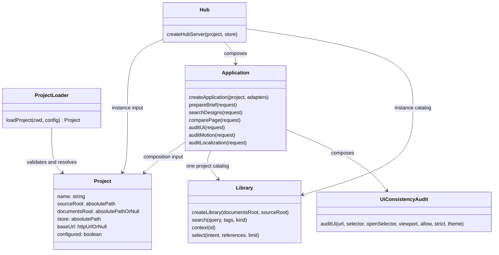

# C4 · 프로젝트 경계의 코드 계약

이 지도는 프로젝트 설정 → 실행 조립 → 조회·검토 경계를 확대한다. 모든 파일의 함수 목록을 복제하지 않고 독립 배포와 프로젝트 격리를 결정하는 계약만 표시한다.

| 계약 | 실제 코드 | 회귀 검증 |
|---|---|---|
| 명시 설정 또는 cwd 상위 설정 탐색, 설정 파일 기준 상대 경로 해석 | [`loadProject`](../../src/project.js) | [`project-boundary.test.js`](../../tests/project-boundary.test.js) |
| 프로젝트별 카탈로그·원본을 주입받는 조립 | [`createApplication`](../../src/application.js), [`createHubServer`](../../hub/server.js) | 동시 Alpha / Beta 서버의 이름·카탈로그·저장 위치 격리 |
| CLI와 서버가 같은 store 사용 | [`parseInvocation`](../../src/cli/parser.js), [`runCli`](../../src/cli/index.js) | 별도 소비 프로젝트에서 실제 CLI 실행 |
| 프로젝트 없는 빈 카탈로그 | [`loadDesigns`](../../src/library/catalog.js) | 외부 설치본 검색 결과에 Design Home 자료 없음 |
| 학습 사이트 없는 배포 UI | [`package-runtime.mjs`](../../scripts/package-runtime.mjs) | npm pack → 임시 폴더 설치 → 브라우저 품질 점검 |
| 화면 원본과 호스트 연결 | [`hub/index.html`](../../hub/index.html), [`export-library.mjs`](../../scripts/export-library.mjs) | 공개 Pages와 독립 설치본의 같은 도구 화면 |
| 시스템 기본 UI 신호와 선택적 게이트 | [`shared/js/design-system-audit-runtime.js`](../../../shared/js/design-system-audit-runtime.js), [`audit/ui.js`](../../src/audit/ui.js), [`commands.js`](../../src/cli/commands.js) | 실제 Chromium에서 열린 Shadow DOM·iframe·화면 상태를 검사하며 누락 프레임은 오류, `--strict`에서만 신호로 실패 |
| 전환 검토 신호와 근거 | [`audit/motion-scenario.js`](../../src/audit/motion-scenario.js), [`audit/motion.js`](../../src/audit/motion.js), [`audit/motion-evidence.js`](../../src/audit/motion-evidence.js) | 시나리오 검증, 프레임·이벤트 관찰, 근거 비교를 분리; CLI가 선택적 정책과 기록 제공 |
| 상태별 색 대비 | [`audit/contrast.js`](../../src/audit/contrast.js) | 프로젝트 시나리오의 상태·테마를 열고 axe-core 결과와 검사 범위를 반환 |
| 언어 연결 검사 | [`audit/localization.js`](../../src/audit/localization.js) | 프로젝트가 언어별 버튼·문자 패턴·범위를 제공하며 도구는 본문과 접근성 문구·재접속 상태 검사 |

프로젝트별 설정은 단일 원본이다. store 명시 인자와 기존 환경 변수는 실행 시 재정의에 사용한다. 자료 메타데이터는 프로젝트 문서, 비교 조건은 등록 레코드가 소유한다. UI 표시 상태는 URL에서 파생한다.

상위 지도: [C1](c1-context.md) · [C2](c2-containers.md) · [C3](c3-components.md).

## MOD-001 · 순수 계약과 전송 조립

Domain의 `capture-contract`가 조건 검증과 측정 스타일을 소유한다. Capture의 동명 진입점은 호환 Facade이며 export의 동일성은 mod_001로 검증한다. Library는 Application·Capture·HTTP를 참조하지 않는다.

Hub의 `createApiHandler`는 주입된 기능을 HTTP 응답으로 변환한다. `createHubServer`는 인스턴스별 조립·GET 정책·정적 파일 경계·오류 응답을 소유한다. 프로젝트 격리와 패키지 실행은 기존 project-boundary 테스트로 검증한다.
